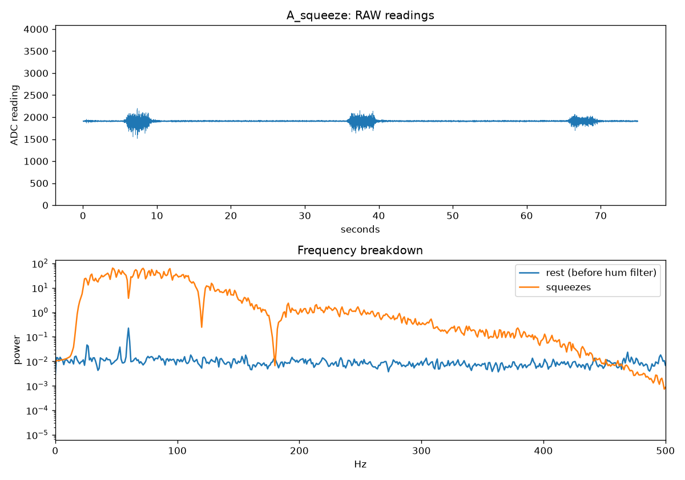
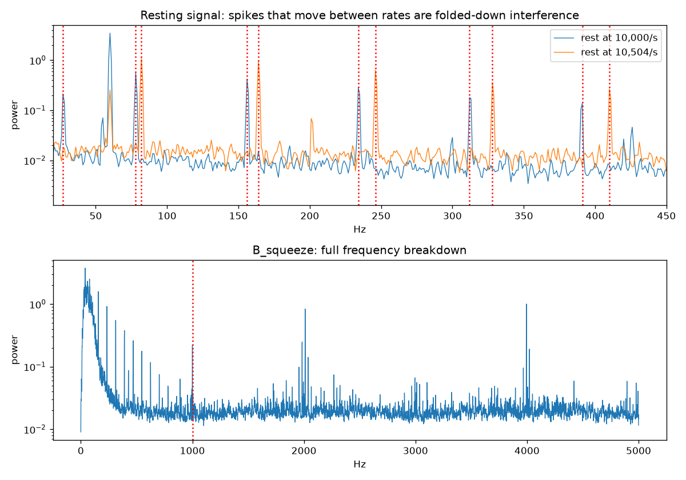
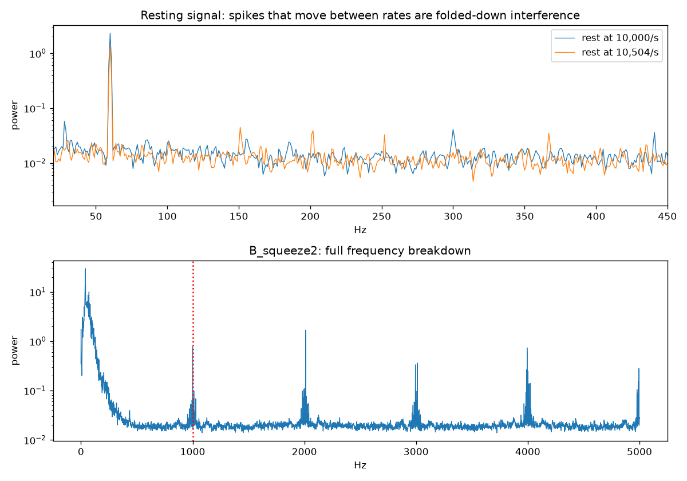
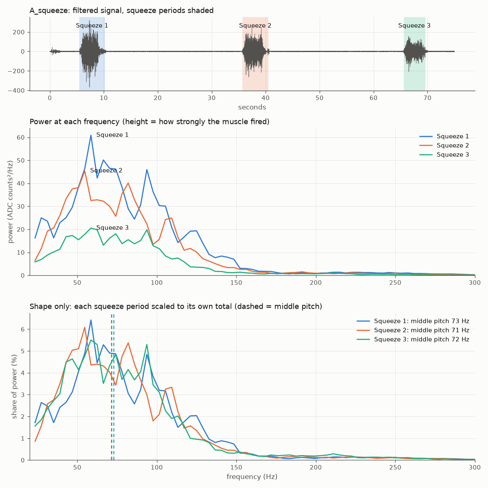
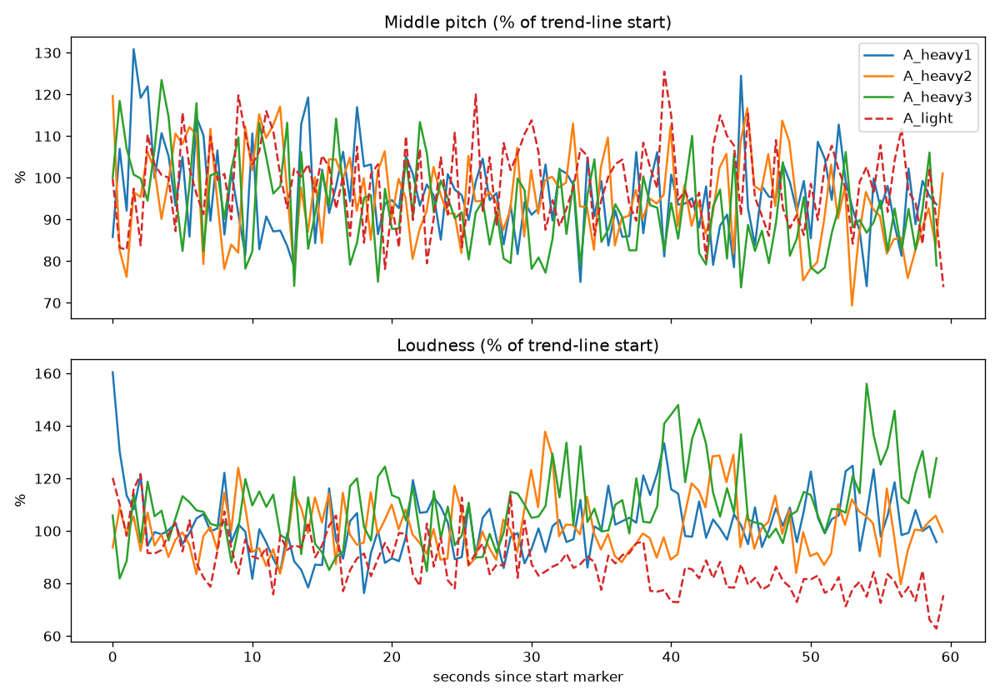
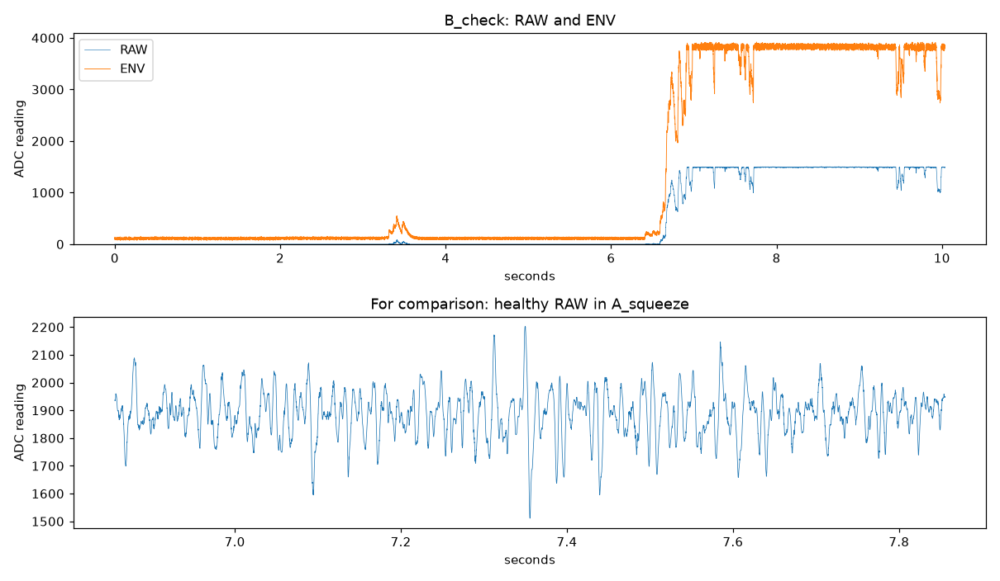

# EMG sensor testing: biceps fatigue wearable

Proof-of-concept testing for a capstone wearable that estimates biceps fatigue. Before building the full system, we tested whether a **MyoWare 2.0** surface EMG sensor read by an **ESP32-S3** can pick up a fatigue marker in the biceps at all.

EMG (electromyography) is the muscle's electrical signal. The fatigue marker is a drop in the signal's median frequency.

Two sessions, two people: 2026-10-27 (Person A) and 2026-10-29 (Person B).

> **Verdict: viable, go ahead.**
> - The recording chain is proven: a clean signal in both people, no lost data, no aliasing.
> - Median frequency fell in **5 of 6 loaded holds** and did not fall in the light control holds.
> - The fatigue result is **supportive, not proven**: only 1 of 6 loaded holds met our full pre-set pass rule, mainly because the holds were lighter than planned.
> - Dynamic curls, the real use case, are the next test.

**Contents:**
1. [Photos](#photos)
2. [What we measure](#what-we-measure)
3. [Hardware](#hardware)
4. [Firmware](#firmware)
5. [Recording](#recording)
6. [Analysis](#analysis)
7. [Test protocol](#test-protocol)
8. [Results](#results)
9. [Debugging log](#debugging-log)
10. [Verification](#verification)
11. [Diagnostics](#diagnostics)
12. [Reproduce](#reproduce-everything)
13. [Layout](#repository-layout)
14. [Limitations and next steps](#limitations-and-next-steps)

---

## Photos
<!-- Uncomment as photos are added to images/ (see images/README.md for the shot list)


-->
*Photos coming.*

## What we measure
The MyoWare picks up the combined electrical buzz of the biceps' muscle fibers through gel electrodes on the skin. It has three outputs:
- **RAW:** the amplified buzz itself. **All frequency analysis uses RAW.**
- **ENV:** a smoothed "how hard is the muscle working" line. Used only to find when reps start.
- **RECT:** the rectified buzz. Not used.

The analysis computes two numbers from RAW:
- **Loudness:** RMS (root mean square), the overall strength of the signal.
- **Middle pitch:** MDF (median frequency), the frequency that splits the signal's power in half.

As a muscle tires, electrical pulses travel along its fibers more slowly, so **middle pitch falls**. The brain also recruits extra fibers to hold the same weight, so **loudness rises**. Each sign alone can be faked; the pair is what identifies fatigue:

| Middle pitch | Loudness | Most likely meaning |
|---|---|---|
| down | up | **Fatigue** |
| up | up | Trying harder (heavier load) |
| down | down | Easing off |
| up | down | Recovering |

## Hardware
| Part | Notes |
|---|---|
| MyoWare 2.0 Muscle Sensor | Powered from 3.3 V (not 5 V: its outputs swing up to its supply, and the ESP32-S3 pins can't take more than 3.3 V) |
| ESP32-S3-N16R8 dev board | USB to the laptop. GPIO 35–37 are used by the 8 MB memory chip, so they're avoided |
| Gel electrodes | Fresh every session |
| Laptop | **Run on battery with the charger unplugged:** this is safer for the person wired to the circuit and removes most 60 Hz hum |

**Wiring:**

| MyoWare | ESP32-S3 |
|---|---|
| + | 3V3 |
| − | GND |
| RAW | **GPIO 4** (GPIO 1 in Person A's session) |
| ENV | GPIO 2 |
| RECT, REF | not connected |

**Electrode placement (SENIAM standard):**
1. Measure from the elbow crease to the shoulder tip.
2. Centre the two electrodes **one-third of that distance above the crease**, on the middle of the biceps and aligned with the muscle: MID toward the shoulder, END toward the elbow.
3. Put the reference electrode on the elbow bone.

Person A's session used the older "mid-biceps" spot.

**Anti-aliasing filter:** a 1 kΩ series resistor with 100 nF to GND at the ADC pin is recommended but **not fitted**. Instead, the Test 2 spike check runs at the start of every session; see [Test 2](#test-2--aliasing-check).

## Firmware
`firmware/emg_recorder/emg_recorder.ino` (Arduino, ESP32 core 3.x):

**How it samples:**
- **The ADC (analog-to-digital converter) runs in hardware-timed DMA mode** (direct memory access), alternating RAW and ENV at **10,000 readings/s each**. Readings stay evenly spaced whatever the code is doing.
- **12-bit readings (0–4095)** over about 0–3.1 V.
- **Wi-Fi and Bluetooth are never started,** because they add ADC noise.

**How it sends data:** binary packets over the board's native USB port, **one packet every 10 readings**. Every packet causes a tiny glitch on the ADC. With one packet per 10 readings, every echo of that glitch lands on a multiple of 1,000 Hz, outside the 20–450 Hz muscle band. The first version sent 128 readings per packet, which put glitch spikes at 78, 156, 234… Hz; see the [debugging log](#debugging-log).

**Packet format** (little-endian):

| Field | Type |
|---|---|
| sync marker `0x5AA5` | uint16 |
| board time, µs | uint32 |
| pair count | uint16 |
| overflow count (frames lost on the board) | uint32 |
| then *pair count* × (RAW, ENV) | uint16, uint16 |

**Commands from the laptop:** `RATE <hz>` changes readings per second per pin (1,000–15,000), which Test 2 uses.

**Build and flash** through the board's **USB** port, with *USB CDC On Boot* enabled so the serial output goes over that port:
```bash
arduino-cli compile --upload -p /dev/cu.usbmodem101 --fqbn esp32:esp32:esp32s3:CDCOnBoot=cdc firmware/emg_recorder
```

## Recording
`log_emg.py` records one trial to `data/NAME.csv` + `data/NAME.json`.

```bash
python log_emg.py A_rest --seconds 10                  # fixed-length recording
python log_emg.py A_rest_10500 --seconds 10 --rate 10500
python log_emg.py A_squeeze --squeeze-cues             # Test 1: spoken "Squeeze"/"Relax" at 5, 35, 65 s
python log_emg.py A_heavy1 --hold                      # Test 3: 5 s countdown, 60 s hold, spoken cues
```

**What it does:**
- **Finds the port automatically.** It opens the port normally, because presetting DTR/RTS off actually reboots the ESP32-S3, then discards stale data.
- **Spoken cues** use macOS `say`, so the person holding the weight never needs the screen. Timed modes place the `start`/`end` markers automatically.
- **Manual markers:** typing a label and pressing Enter adds one.
- **It reports any data loss:** board overflows, byte resyncs, or board reboots (the board clock jumping back) mark the trial `LOST DATA`.
- **It prints a range check after every trial** (RAW min/max, ENV max) and warns about clipping or ENV maxing out.

## Analysis
`analyze.py` has one subcommand per test, prints PASS/FAIL per rule, and saves plots to `results/`.

**Pipeline:**
1. Centre RAW, then apply an anti-aliasing filter and keep every 5th reading, giving 2,000 readings/s.
2. Band-pass 20–450 Hz (4th-order Butterworth, run forward and back so nothing shifts in time).
3. Notch out 60, 120 and 180 Hz wall hum.
4. Cut into **0.5 s slices with no overlap,** which keeps the statistics honest. For each slice:
   - **loudness** (RMS);
   - **middle pitch:** Welch spectrum, then the frequency where the running total of power crosses half.
5. **Trend:** a straight-line fit through the whole trial. The % change is from the line's start to its end; **"chance random"** is the fit's p-value. Using the whole line keeps one jumpy slice from deciding the result.
6. **Effort** = loudness ÷ loudness of the strongest squeeze (the top 10% of squeeze slices).
7. **Curls:**
   - a rep starts when ENV rises through 30% of the way from rest to peak; `--cadence 2.0` instead takes the loudest 400 ms of each 2 s period;
   - each rep is measured over a 400 ms window.

| Command | Test |
|---|---|
| `analyze.py signal --rest R --squeeze S` | Test 1, signal check |
| `analyze.py alias --rest R --rest-alt R10500 --squeeze S` | Test 2, aliasing check |
| `analyze.py squeezes --squeeze S [--rest]` | Compare each squeeze (or each rest period) in a squeeze recording |
| `analyze.py hold --light L --heavy H1 H2 H3 [--squeeze S]` | Test 3, still holds (`--squeeze` adds the effort %) |
| `analyze.py curls --light L --sets S1 S2 [--cadence 2.0]` | Test 4, curls. **Code is ready; not yet run on real data** |

## Test protocol
**Session setup:**
1. Electrodes at the SENIAM spot, with skin shaved, alcohol-wiped and dry.
2. Jumpers taped down.
3. Laptop on battery.
4. Arm fully relaxed for rest recordings: forearm supported, palm up, hand limp.

| Test | Procedure | Pass rules |
|---|---|---|
| **1. Signal check** | 10 s relaxed rest, then 3 max squeezes (elbow at a right angle, pushing up into the underside of a table), 30 s apart: timed by hand for Person A, 3 s each on spoken cues for Person B | No lost readings · squeeze loudness ≥ 10× rest · < 0.1% of readings at the ADC limits (0 or 4095) · 60 Hz hum < 1% of squeeze power · squeeze middle pitch 50–120 Hz |
| **2. Aliasing check** | 10 s relaxed rest at 10,000/s and again at 10,500/s | No spike (10 dB above its neighbours, 20–450 Hz) moves between the two rates. Real signals stay put; interference folded down from high frequencies moves |
| **3. Still holds** | Upper arm at the side, elbow at a right angle: one light 60 s hold, then three heavy 60 s holds with 10 min rests | Heavy: middle-pitch trend ≤ −10% with chance random < 5%, and loudness rising believably · Light: no believable trend over 5% · Recovery: hold 2 starts within 5% of hold 1. If the arm gives out early, analysis stops where loudness falls below 40% of its start |

**All pass rules were fixed before any real hold data was recorded.**

## Results
### Test 1: signal check
| | Person A | Person B |
|---|---|---|
| Squeeze loudness vs rest | **31.5×** | **28.4×** |
| Readings at the ADC limits | 0.000% | 0.000% |
| 60 Hz hum (% of squeeze power) | 0.01% | 0.08% |
| Squeeze middle pitch | 72 Hz | 51 Hz |
| Result | **PASS 6/6** | **PASS 6/6** |



B's lower middle pitch is a normal difference between people (more tissue between muscle and skin lowers it). It's why every fatigue rule compares a person to their own starting value.

### Test 2: aliasing check
| | Person A | Person B (128-reading packets) | Person B (10-reading packets) |
|---|---|---|---|
| Moving spikes | none | 78, 156, 234… Hz and 82, 164, 246… Hz | none |
| Middle pitch: plain 2,000/s vs filtered | 72.2 vs 72.3 Hz | 64.8 vs 61.9 Hz | 51.2 vs 51.0 Hz |
| Result | **PASS** | FAIL | **PASS** |




**Plain 2,000/s sampling gives the same middle pitch, within 0.6%,** so the final device can sample at 2,000/s.

### Squeeze and rest comparison
| Person A | Squeeze 1 | Squeeze 2 | Squeeze 3 |
|---|---|---|---|
| Loudness (% of squeeze 1) | 100% | 89% | 62% |
| Middle pitch | 73 Hz | 71 Hz | 72 Hz |

Loudness fell while middle pitch held: **less effort, not fatigue.** The sensor separates the two.

True rest measured about 2% of squeeze loudness for Person A and 3–4% for Person B, with a flat electrical-noise shape. Rest returned to the same level after every squeeze. Person A's first rest period was louder and muscle-shaped, because they hadn't settled yet.



### Test 3: still holds
✓ = believable trend (chance random < 5%). From `diagnostics/hold_summary.py`.

| Hold | Effort | Length | Middle pitch | Loudness |
|---|---|---|---|---|
| A light | 22% | 60 s | −2.6% | −24% ✓ (eased off) |
| A heavy 1 | 30% | 60 s | **−7.8% ✓** | +5% |
| A heavy 2 | 26% | 60 s | **−9.2% ✓** | +3% |
| A heavy 3 | 26% | 60 s | **−14.6% ✓** | **+20% ✓** |
| B light | 18% | 60 s | −5.9% (chance random 5.2%) | −21% ✓ (eased off) |
| B trial 1 | 84% | 10 s | **−28.1% ✓** | +21% |
| B trial 2 | 43% | 10 s | **−22.7% ✓** | −4% |
| B trial 3 | 74% | 10 s | +15.5% | −3% |



**Test 3 by its pre-set rules: FAIL** (A: 7/12). Only A heavy 3 met both conditions. The likely cause:
- A's "heavy" holds were only 26–30% effort against a 50–60% target, close to the 22% light hold.
- B's loaded holds were 10 s weight-finding trials, not planned 60 s holds.

### How noisy one reading is
From `diagnostics/slice_noise.py`:
- One 0.5 s middle-pitch reading scatters about **10%** around the trend, in every hold, for both people.
- The real drift is only **0.02–0.12% per slice**.

So a single reading is almost pure noise. About 25 slices (12 s) are needed for ±2% precision. Any live tracker, a Kalman filter for example, needs that much memory. Its measurement noise can be measured directly (10%) rather than tuned.

### Verdict
**Proven:**
1. **A reliable data chain:** 10,000 readings/s and 0 lost readings in every recording after the fixes.
2. **A clean signal in both people:** 28–31× above rest, no clipping, hum under 0.1%.
3. **No aliasing at 10,000/s,** and a 2,000/s final device is fine.
4. **Effort changes are told apart from fatigue.**
5. **Middle pitch falls under load in 5 of 6 loaded holds,** not in the light holds, and faster at higher effort.

**Inconclusive:**
1. **The full pre-set rule** (≥ 10% drop *and* rising loudness) was met by only 1 of 6 loaded holds.
2. **No 60 s hold at the target 50–60% effort exists.**
3. **Rising loudness** was believable in only 1 of 6 loaded holds.
4. **One trial went the other way** (+15.5%, not believable).
5. **The sample is small:** 2 people, 1 session each. Person A used the old electrode spot, and A's recovery check was borderline (+5.1% against a 5% limit).
6. **Curls are untested.**

The full written summary is in [`docs/SENSOR_TESTING.md`](docs/SENSOR_TESTING.md).

## Debugging log
In the order things happened:

| # | Symptom | Cause (evidence) | Fix |
|---|---|---|---|
| 1 | No data reached the laptop | The firmware's serial output went to the COM/UART pins, while only the USB port worked. `usb_probe.py` showed 0 packets | Build with `CDCOnBoot=cdc` |
| 2 | A 5 s test recording reported 4,294 s and extra readings | Presetting DTR/RTS off before opening the port **rebooted** the chip. `usb_probe.py` showed ROM boot text and the board clock jumping back | Open the port normally; discard stale data for 1.5 s; flag reboots as lost data |
| 3 | Nobody could type markers while holding a weight | — | Timed modes (`--hold`, `--squeeze-cues`) with spoken cues and automatic markers |
| 4 | Test 3 holds barely moved | The load was too light: effort 26–30% vs 22% for the light hold | Added the effort readout (`--squeeze`) and weight-finding trials |
| 5 | RAW sat at 0 and copied ENV's shape (`B_check`) | The firmware read GPIO 1 while RAW was wired to GPIO 4. An unconnected pin picks up a ghost of the previous channel | Firmware reads GPIO 4 |
| 6 | Rest only 8× quieter than a squeeze (`B_check2`) | The arm wasn't relaxed: 90% of rest power was below 150 Hz, a muscle shape (`noise_sources.py`) | Relaxation protocol for rest recordings |
| 7 | Test 2 failed with spikes at 78/156/234… Hz (`B_rest`) | USB packet glitches: one packet per 128 readings is 78/s. `packet_noise.py` measured 9.2 counts vs 2.8 in A's wiring | One packet per 10 readings: echoes at 1 kHz steps, outside the band. Re-tested: no moving spikes |
| 8 | 262% "effort" on a light hold; RAW rail to rail (`B_light`) | The RAW jumper came loose; ENV stayed normal | Re-seated and taped the jumper; recording excluded |
| 9 | The anti-aliasing capacitor couldn't be fitted | — | Test 2 spike check at the start of every session |



## Verification
Two test suites; no board needed.

```bash
python tests/test_logger.py      # 5 tests: packet decoding, lost-byte detection, spoken-cue timing
python tests/test_analysis.py    # 9 tests: every analyze.py command on simulated data with known answers
```

- `tests/make_sim.py` writes simulated recordings in the logger's format:
  - good data that must PASS;
  - no-fatigue holds and a folded-down 300 Hz tone that must FAIL;
  - a control hold that really drifts, which must fail the control check;
  - a hold where the arm gives out at 40 s, which must be cut at 40 s.
- **The simulation shaped the rules:**
  - Judging trends from the first 2 s or the first 3 reps was too jumpy, so every rule uses the whole trend line.
  - A flat light curl set drifted ±6% by chance, so a control fails only on a *believable* trend over 5%.
  - With one 400 ms window per rep, a 16-rep set with an 18% drop is **not** reliably detected. That limit matters for curl analysis.

## Diagnostics
One-off checks run during testing, kept as scripts. Each one's docstring says which question it answered.

| Script | Question |
|---|---|
| `diagnostics/usb_probe.py` | Is the board sending packets? Does opening the port reboot it? |
| `diagnostics/check_recording.py` | Is RAW centred, clipping, or acting like a broken input? |
| `diagnostics/packet_noise.py` | Is there a glitch repeating once per USB packet? |
| `diagnostics/noise_sources.py` | Is background noise muscle, hum, or electrical hiss? Any spikes? |
| `diagnostics/hold_summary.py` | Effort and trends for every hold in one table |
| `diagnostics/slice_noise.py` | How noisy is one middle-pitch reading vs the real drift? |

## Reproduce everything
```bash
pip install -r requirements.txt
./reproduce.sh                   # regenerates every figure in results/ and every report in results/reports/
python tests/test_logger.py
python tests/test_analysis.py
```

## Repository layout
```
emg-sensor-testing/
├── README.md
├── reproduce.sh                  # regenerate all results from data/
├── requirements.txt
├── firmware/emg_recorder/        # ESP32-S3 recorder (Arduino)
├── log_emg.py                    # laptop recorder
├── analyze.py                    # Tests 1-4 + squeeze/rest comparison
├── diagnostics/                  # one-off investigations, as scripts
├── tests/                        # simulation + logger tests
├── data/                         # every recording (gzipped CSV + JSON) and a manifest
├── results/                      # figures, diagnostics figures, text reports
├── docs/SENSOR_TESTING.md        # one-page summary
└── images/                       # photos (to add)
```

## Limitations and next steps
- **What limits these results:** 2 people, 1 session each, holds lighter than planned, no anti-aliasing capacitor, and per-rep middle pitch that is noisy.
- **Next phase:** data collection for the full wearable, with curls, a wrist IMU (motion sensor) on the same ESP32-S3, and a reps-until-form-breakdown label. That design is documented separately.
- **Optional confirmation:** one 60 s hold at 50–60% effort would upgrade the static result from "supportive" to "passed".
